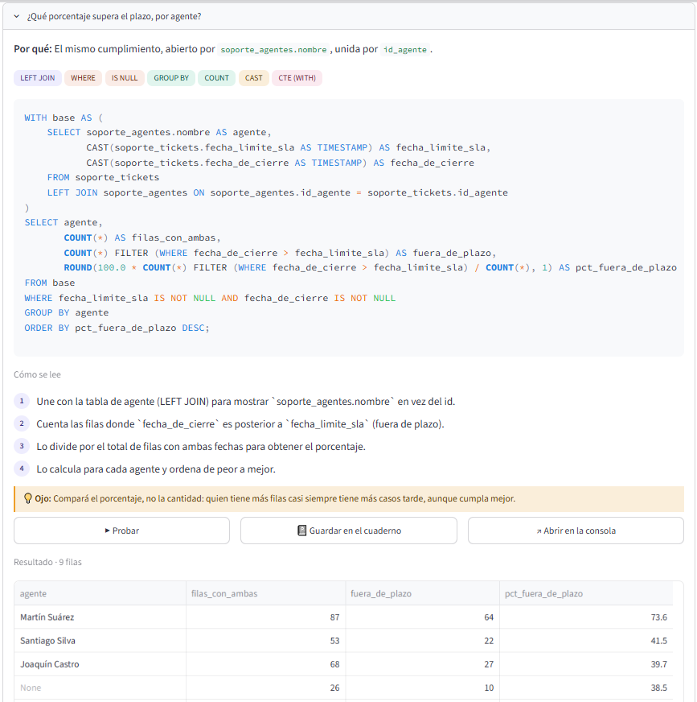
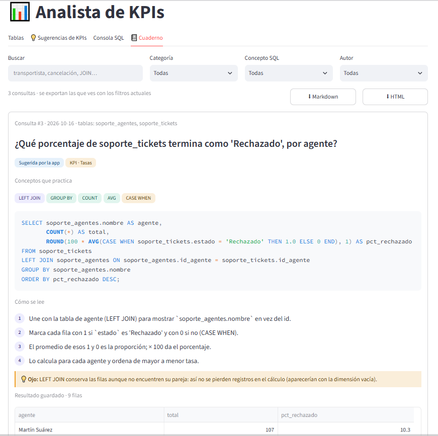
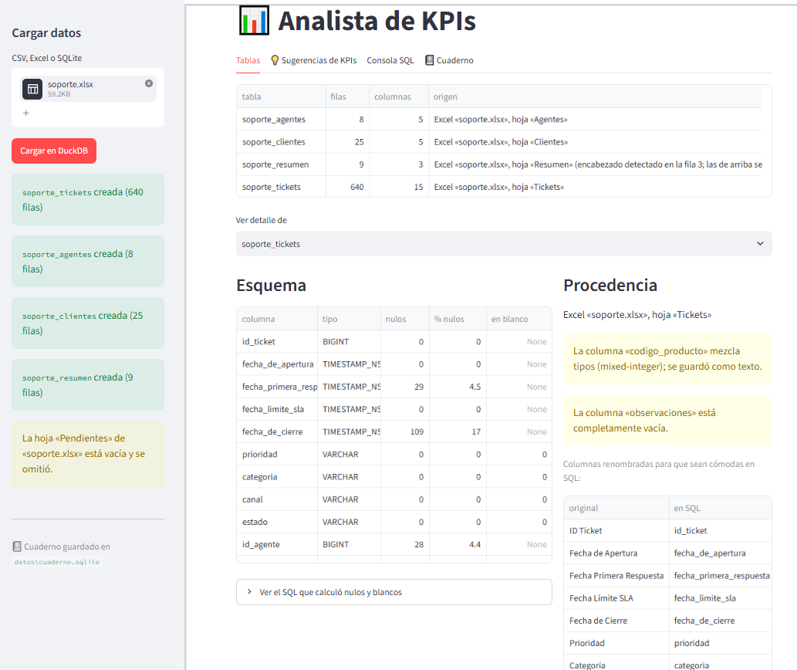

# Analista de KPIs con SQL


**A partir de un Excel, CSV o base SQLite, la app crea tablas consultables con SQL, detecta problemas de calidad, propone KPIs con su consulta explicada y guarda cada análisis en un cuaderno de estudio.**

Funciona con cualquier archivo: no tiene nombres de tablas ni de columnas escritos a mano. Lo probé con dos rubros distintos, logística y mesa de ayuda, sin cambiar una línea de código entre uno y otro.

> Lo construí mientras me preparaba para un puesto de Analista de Datos, para practicar SQL con datos propios y entender cada decisión técnica en lugar de solo usar herramientas.

---

## Capturas

**Una sugerencia de KPI:** la regla que la disparó, el SQL, cómo se lee y el resultado.



**El cuaderno de consultas:** cada análisis guardado con su explicación, para buscar y volver a ejecutar.



**Carga y calidad:** un Excel con varias hojas convertido en tablas, con su esquema, los nulos por columna, los avisos de calidad y las columnas renombradas.



---

## Qué hace

1. **Carga genérica.** Cada CSV, hoja de Excel o tabla de SQLite queda como una tabla en DuckDB. El archivo original no se modifica.
   - Detecta el separador y la codificación de los CSV (`;`, `,`, UTF-8, Windows-1252).
   - Encuentra el encabezado aunque la hoja tenga títulos arriba.
   - Pasa los nombres a `snake_case` sin tildes (`Fecha Límite SLA` → `fecha_limite_sla`) y muestra qué renombró.
2. **Perfil y calidad.** A cada columna le asigna un *rol* (id, fecha, número, escala, categoría, texto). Detecta fechas guardadas como texto, columnas que mezclan tipos, columnas vacías y relaciones entre tablas (`tickets.id_agente` → `agentes.id_agente`).
3. **Sugerencias de KPIs por reglas.** Propone volumen por mes, tasas (cancelado, rechazado), tiempos de ciclo, cumplimiento de plazos o SLA, satisfacción (top-2-box), rankings e integridad referencial. Cada sugerencia trae el SQL, **qué regla la disparó**, cómo se lee paso a paso y un "ojo" con la trampa a evitar.
4. **Consola SQL** para escribir consultas propias sobre las tablas cargadas.
5. **Cuaderno de consultas.** Guarda pregunta, SQL, explicación, resultado y fecha. Se puede buscar sin importar las tildes, filtrar por concepto SQL (JOIN, ventanas, CTE…), volver a ejecutar comparando con el resultado guardado y exportar a Markdown o HTML.

---

## Caso de análisis: mesa de ayuda

Con [`ejemplos/soporte.xlsx`](ejemplos/soporte.xlsx) (640 tickets, 8 agentes, 25 clientes; datos ficticios):

| KPI | General | Agente con peor resultado |
|---|---|---|
| Tickets fuera de SLA | 27,1 % | **73,6 %** |
| Satisfacción 4 o 5 (sobre 5) | 65,3 % | **33,9 %** |
| Horas dedicadas por ticket | ~6 h | **13,6 h** |

El mismo agente aparece último en los tres indicadores y además tiene la mayor tasa de tickets rechazados. Los datos no explican la causa: ¿falta de capacitación, o le asignan tickets más complejos? El siguiente paso sería cruzar sus tickets por prioridad y categoría.

La consulta que generó la app para el SLA por agente:

```sql
WITH base AS (
    SELECT soporte_agentes.nombre AS agente,
           CAST(soporte_tickets.fecha_limite_sla AS TIMESTAMP) AS fecha_limite_sla,
           CAST(soporte_tickets.fecha_de_cierre AS TIMESTAMP) AS fecha_de_cierre
    FROM soporte_tickets
    LEFT JOIN soporte_agentes ON soporte_agentes.id_agente = soporte_tickets.id_agente
)
SELECT agente,
       COUNT(*) AS filas_con_ambas,
       COUNT(*) FILTER (WHERE fecha_de_cierre > fecha_limite_sla) AS fuera_de_plazo,
       ROUND(100.0 * COUNT(*) FILTER (WHERE fecha_de_cierre > fecha_limite_sla) / COUNT(*), 1) AS pct_fuera_de_plazo
FROM base
WHERE fecha_limite_sla IS NOT NULL AND fecha_de_cierre IS NOT NULL
GROUP BY agente
ORDER BY pct_fuera_de_plazo DESC;
```

La CTE `base` prepara los datos una sola vez: trae el nombre del agente y lleva las fechas a `TIMESTAMP` (pandas las entrega con precisión de nanosegundos). El `LEFT JOIN` conserva los tickets sin agente asignado, que aparecen como `None`.

**Un error que encontré probando:** la primera versión comparaba solo el *día* de cierre con el día límite. Daba 10,4 % fuera de SLA, cuando el valor real es 27,1 %: un ticket que vencía a las 10:00 y se cerraba a las 18:00 del mismo día contaba como "a tiempo". Ahora, si las fechas tienen hora, la app compara el momento exacto y mide los tiempos en horas. Una prueba automática verifica ese caso.

### También con logística

Con [`ejemplos/operaciones.db`](ejemplos/operaciones.db) (2.046 pedidos, 4 tablas; datos ficticios):
- El **20,4 %** de las entregas llega después de la fecha prometida. Un transportista llega tarde en el **36,5 %** de sus entregas, contra 12–16 % de los demás.
- Un depósito cancela el **10,7 %** de sus pedidos, más del doble que los otros dos.
- **5 pedidos** apuntan a clientes que no existen (detectado con un anti-join).

---

## Qué practica este proyecto

**SQL:** `JOIN` y `LEFT JOIN` · anti-join (`LEFT JOIN … WHERE … IS NULL`) · `GROUP BY` / `HAVING` · CTE (`WITH`) · funciones de ventana (`RANK`, `SUM(COUNT(*)) OVER ()`) · `CASE WHEN` para tasas (`AVG` de 0/1) · `COUNT(*) FILTER (WHERE …)` · fechas (`DATE_TRUNC`, `DATE_DIFF`, `TRY_CAST`, `TRY_STRPTIME`) · `information_schema` · funciones JSON de SQLite (`json_each`).

**Python:** pandas (tipos *nullable*, detección de tipos mezclados) · DuckDB y SQLite desde Python · Streamlit (`session_state`, formularios, callbacks) · `dataclasses` · expresiones regulares · pruebas con pytest.

**Análisis y calidad de datos:** perfilado de columnas · integridad referencial · métricas robustas (mediana además del promedio) · escalas de satisfacción (top-2-box en vez de sumar) · comparar tasas en lugar de cantidades.

---

## Cómo correrla

```bash
git clone https://github.com/Ladydlozada/analista-kpis-sql.git
cd analista-kpis-sql
python -m venv .venv
.venv\Scripts\activate           # Mac/Linux: source .venv/bin/activate
pip install -r requirements.txt
streamlit run app.py
```

Después, en la barra lateral, cargar `ejemplos/soporte.xlsx` o `ejemplos/operaciones.db` y abrir la pestaña **💡 Sugerencias de KPIs**.

Para correr las pruebas:

```bash
pytest -q
```

---

## Cómo está organizado

```
app.py              Barra lateral de carga y pestañas; delega en vistas/
vistas/             Una pantalla por archivo (tablas, sugerencias, consola, cuaderno)
nucleo/             Lógica sin interfaz, probada con pytest
  cargadores.py     CSV / Excel / SQLite → DataFrames (no conoce DuckDB ni Streamlit)
  almacen.py        Tablas en DuckDB, esquema, nulos y blancos con SQL
  perfil.py         Rol de cada columna y relaciones entre tablas
  sugerencias.py    Reglas que proponen KPIs a partir del perfil
  cuaderno.py       Cuaderno en SQLite, con migración de esquema
  conceptos.py      Detecta los conceptos SQL de una consulta
  exportar.py       Exporta a Markdown y HTML
tests/              55 pruebas, incluida una que ejecuta cada SQL sugerido en DuckDB
ejemplos/           Archivos ficticios para probar la app
```

Algunas decisiones que tomé:
- **DuckDB para analizar, SQLite para el cuaderno.** DuckDB es analítico: recorre y agrega muchas filas rápido. SQLite es transaccional: guarda, edita y borra registros sueltos. Cada uno hace lo que mejor sabe hacer.
- **Primero diagnosticar, después transformar.** Los tipos se convierten *después* de buscar problemas. Si se convierten al leer, una columna con `1, "A-2", 3` se vuelve texto y ya no se puede saber que estaba mezclada.
- **Transparencia.** Cada sugerencia dice qué regla la disparó, y cada consulta muestra su SQL.

El detalle completo está en [`docs/decisiones.md`](docs/decisiones.md).

---

## Próximos pasos

- [ ] **Modo estudio:** la app muestra la pregunta, yo escribo mi SQL, y la app ejecuta las dos versiones y compara los resultados antes de mostrar la solución.
- [ ] **Validaciones de calidad genéricas** con informe descargable: fechas imposibles, duplicados por clave, valores fuera de rango.
- [ ] **Preguntas en lenguaje natural** con la API de Claude: el modelo recibe el esquema y la pregunta, y devuelve SQL con explicación.
- [ ] Demo en línea con Streamlit Community Cloud.

---

**Leidy Lozada** · Automatización con Python y análisis de datos · [GitHub](https://github.com/Ladydlozada)
